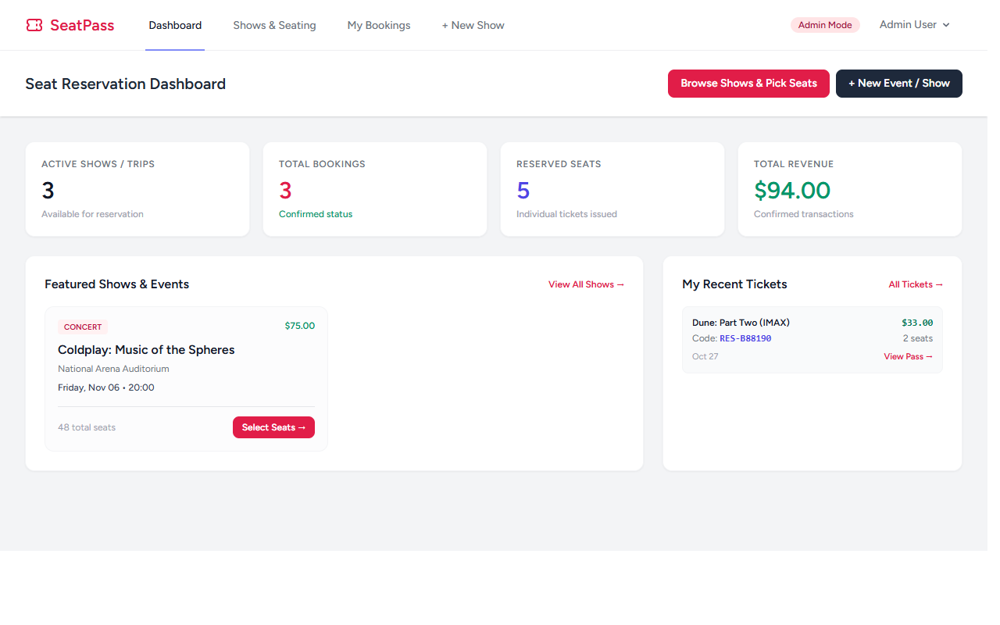

# FinFlow - Personal Finance & Budget Tracker

Repository: https://github.com/0xyz-exe/personal-finance-app-laravel

A personal finance management, cashflow tracking, and monthly budget control application built with Laravel 13, Blade, Tailwind CSS, Alpine.js, and SQLite.

## Features

- ✅ **Multi-Account Wallets**: Manage liquid cash, checking bank accounts, savings, and credit cards with real-time balance calculations.
- ✅ **Income & Expense Transactions**: Record income and expense entries linked to custom wallets and categories with notes and dates.
- ✅ **Category Budget Caps**: Define monthly budget allowances per category with live visual progress bars and over-budget warnings.
- ✅ **Cashflow Metrics**: Track monthly net cashflow, aggregate balances, and top expenditure streams on a responsive dashboard.
- ✅ **Search & Filter**: Search transactions by keyword, filter by transaction type, wallet account, or category.

## Tech Stack

Laravel 13.38.0 · Breeze 2.4 · SQLite · Tailwind CSS · Alpine.js

## Installation

```bash
git clone https://github.com/0xyz-exe/personal-finance-app-laravel.git
cd personal-finance-app-laravel
composer install && npm install && npm run build
cp .env.example .env && php artisan key:generate
touch database/database.sqlite
php artisan migrate --seed
php artisan serve
```

### Demo Accounts

All accounts use the password: `password`

- **Demo User**: `test@example.com` (Jordan Reed - 3 wallets, income/expense history, configured budgets)
- **Admin**: `admin@example.com`

## Database Schema

- **users**: `id`, `name`, `email`, `password`, `is_admin`, `timestamps`
- **wallets**: `id`, `user_id`, `name`, `type` (bank/cash/credit_card/savings/e_wallet), `initial_balance`, `currency`, `color`, `timestamps`
- **categories**: `id`, `user_id`, `name`, `type` (income/expense), `color`, `icon`, `budget_limit`, `timestamps`
- **transactions**: `id`, `user_id`, `wallet_id`, `category_id`, `type` (income/expense), `amount`, `transaction_date`, `title`, `notes`, `timestamps`


## Screenshots

### Dashboard Overview


### Login Overview


## License

MIT
